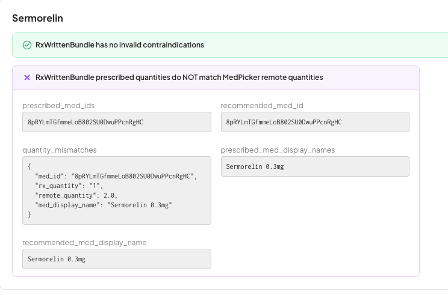
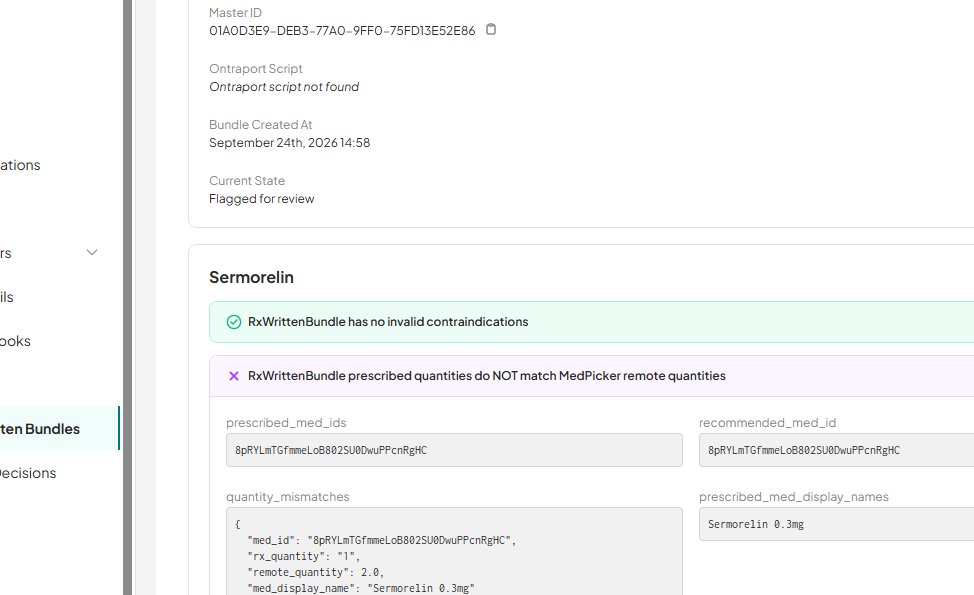

# OM Ciclo 57

> [!Info]
> Del Jueves 8 al Miércoles 21 de Octubre.

## Casos de problemas de Sermorelin en MedPicker 🟢

Etiquetas: #om_bundle_issue #om_bundle_manually_rejected 

Esto es lo mismo que pasó en OM-11617 -> [[OM Ciclo 56#Detalle de OM-11617 - Not at the Pharmacy - Bundle Rejected 🟢]]

Casos:

- OM-11638
- OM-11779

Capturas:

<figure>
    
    <figcaption>Caso OM-11638</figcaption>
</figure>


<figure>
    
    <figcaption>Caso OM-11779</figcaption>
</figure>


### Solución: Tenían que corregir el MedPicker

Cuando le fui a escribir a Sarah se me dio por revisar antes y pude hacer los resubmits.

## Caso OM-11848 - Unable with Current Medication 🟢

Etiquetas: #om_unable_to_continue_with_current_medication

Este error cuando la persona va a seleccionar tratamiento:
![[OM_11848.png]]

Claudio dice que pasa porque:
- para mostrarle su tratamiento actual (Tirzepatide inyectable), la app le pide a MedPicker las opciones para ella y luego se queda solo con las que existen en nuestra tabla de medicamentos (`Salesforce::Medication`).
- MedPicker sí le recomendó 3 opciones de Tirzepatide 12.5mg de PerfectRX, pero ninguna se importó nunca a esa tabla, así que la app las descarta. Solo quedan Semaglutide y Zepbound, la app concluye que su tratamiento "no está disponible" y muestra el modal.

Claudio está diciendo de importar esos MedIds como `Salesforce::Medication` pero no sé si deba hacer eso.

### Solución: crear los medicamentos como Salesforce::Medication

Hoy, 13 de Octubre, volví a revisar y sí dejaba llegar a la parte de seleccionar medicamento. De comprarla. Así que le pedí a claudio una consulta para comprobar que la cosa estuviera en orden.

Esta es la query:
```ruby
ids = %w[qf8LOJi9avCNF02x7Wb9cNDkPDUnHiGk wGXBEaL06nqTuiwyFggTTObrcWXeBJpL ZRcLdJ595bOcmiBwa63afnq9jxHurZap]
pp Salesforce::Medication.where(med_id: ids).includes(:product).map { |m|
  {med_id: m.med_id, status: m.status, sku: m.product&.sku, desc: m.description,
   rx_strength: m.rx_strength, weeks: m.weeks_of_supply, imported_at: m.imported_from_medpicker_at}
}
```

y la salida fue:
```ruby
[
 {med_id: "qf8LOJi9avCNF02x7Wb9cNDkPDUnHiGk",
  status: "Active",
  sku: "TIRZ-1M-HIGH",
  desc: "PerfectRX Tirzepatide Injection 12.5mg (1 Month) Tirzepatide/B3/B5 20mg/5mg/10mg/1mL - 2.5mL",
  rx_strength: 12.5,
  weeks: 4.0,
  imported_at: 2026-10-13 14:27:44.000000000 UTC +00:00},
  
 {med_id: "ZRcLdJ595bOcmiBwa63afnq9jxHurZap",
  status: "Active",
  sku: "NULL_PRODUCT",
  desc: "PerfectRX Tirzepatide Injection 12.5mg (2 Months) Tirzepatide/B3/B5 20mg/5mg/10mg/1mL - 3mL",
  rx_strength: 12.5,
  weeks: 8.0,
  imported_at: 2026-10-13 14:28:54.000000000 UTC +00:00}
]
```

Hubo el problema del medicamento que quedó con SKU NULL_PRODUCT y hubo un tercer MedId que no se creó. Igual con el MedId que quedó bien se hubiera podido seguir pero decidí corregir todo.

Esto fue lo que corrí:
```ruby
mapping = {
  "qf8LOJi9avCNF02x7Wb9cNDkPDUnHiGk" => "TIRZ-1M-HIGH",
  "wGXBEaL06nqTuiwyFggTTObrcWXeBJpL" => "TIRZ-2M-HIGH",
  "ZRcLdJ595bOcmiBwa63afnq9jxHurZap" => "TIRZ-2M-TITRATE"
}
products = Salesforce::Commerce::Product.where(sku: mapping.values).index_by(&:sku)
raise "missing products: #{mapping.values - products.keys}" unless products.size == 3

missing = mapping.keys - Salesforce::Medication.where(med_id: mapping.keys).pluck(:med_id)
provider = Salesforce::ImportMedicationService::SalesforceObjectProvider.new(warn_on_ambiguous_product: false)

Salesforce::Base.transaction do
  imports = Salesforce::MedpickerImporter.fetch_medications_bulk(missing)
  pp(missing:, returned_by_medpicker: imports.map { it.medication_mapping.medpicker_med_id })
  imports.each { Salesforce::ImportMedicationService.call(it, salesforce_object_provider: provider) }

  Salesforce::Medication.where(med_id: mapping.keys).each do |med|
    med.update!(product: products.fetch(mapping.fetch(med.med_id)), status: "Active")
  end
end
```

Verifiqué con esto:
```ruby
pp Salesforce::Medication.where(med_id: mapping.keys).includes(:product).map { [it.med_id, it.status, it.product.sku] }
```

que sacó:
```ruby
[["qf8LOJi9avCNF02x7Wb9cNDkPDUnHiGk", "Active", "TIRZ-1M-HIGH"],
 ["ZRcLdJ595bOcmiBwa63afnq9jxHurZap", "Active", "TIRZ-2M-TITRATE"],
 ["wGXBEaL06nqTuiwyFggTTObrcWXeBJpL", "Active", "TIRZ-2M-HIGH"]]
```


Cuando volví a correr la query inicial de verificación dio esto:
```ruby
[
{med_id: "qf8LOJi9avCNF02x7Wb9cNDkPDUnHiGk",
  status: "Active",
  sku: "TIRZ-1M-HIGH",
  desc: "PerfectRX Tirzepatide Injection 12.5mg (1 Month) Tirzepatide/B3/B5 20mg/5mg/10mg/1mL - 2.5mL",
  rx_strength: 12.5,
  weeks: 4.0,
  imported_at: 2026-10-13 14:27:44.000000000 UTC +00:00},
  
 {med_id: "ZRcLdJ595bOcmiBwa63afnq9jxHurZap",
  status: "Active",
  sku: "TIRZ-2M-TITRATE",
  desc: "PerfectRX Tirzepatide Injection 12.5mg (2 Months) Tirzepatide/B3/B5 20mg/5mg/10mg/1mL - 3mL",
  rx_strength: 12.5,
  weeks: 8.0,
  imported_at: 2026-10-13 14:28:54.000000000 UTC +00:00},
  
 {med_id: "wGXBEaL06nqTuiwyFggTTObrcWXeBJpL",
  status: "Active",
  sku: "TIRZ-2M-HIGH",
  desc: "PerfectRX Tirzepatide Injection 12.5mg (2 Months) Tirzepatide/B3/B5 20mg/5mg/10mg/1mL - 2.5mL",
  rx_strength: 12.5,
  weeks: 8.0,
  imported_at: 2026-10-13 14:45:49.000000000 UTC +00:00}
  ]
```

Los tres MedIds como `Salesforce::Medication`.

## Caso OM-11828 - Error de Scheduled Clinical Encounter en Salesforce 🟢

Etiquetas: #om_scheduled_clinical_encounter_exists 

El error cuando intenté hacer un ResubmitToMSO:
![[OM_11828.png]]

> `Patient::Checkin::ClinicalEncounterScheduler::NotSchedulable` A scheduled clinical encounter already exists


El problema es que el Member Period tenía dos Clinical Encounters creados casi que al mismo tiempo:
![[OM_11828.b.png]]

Donde el CE con omid `"01a1122b-c571-7e67-b8f5-a652e9d40626"` era el que necesitaba cancelarse pero el sistema estaba agarrando el que aparece después. Que ya estaba cancelado.

Entonces el fix fue hacer el resubmit desde consola pasando este omid (el del CE en scheduled). Así.

Primero se confirma que se devuelve lo que se quiere. Este era un caso de cambio de medicamento entonces queríamos...
```ruby
ce = Salesforce::ClinicalEncounter.find("01a1122b-c571-7e67-b8f5-a652e9d40626")
p = Salesforce::ResubmitToMso.preview(clinical_encounter: ce, overrides: {prescription_strength: 10, weeks_of_supply: 4})

pp p.validation_errors, p.matching_product&.name, p.recommended_medication&.then { {med_id: it.med_id, rx_strength: it.rx_strength, weeks: it.weeks_of_supply} }
```

...esta salida
```ruby
[]
"1-month Tirzepatide (High Dosage)"
{med_id: "EwS6VvRRwnBZhvdE775hKexfka4kKTwm", rx_strength: 10.0, weeks: 4.0}
```

Luego se ejecuta manualmente pasando el Clinical Encounter que nos interesa:
```ruby
r = Salesforce::ResubmitToMso.execute(clinical_encounter: ce, overrides: {prescription_strength: 10, weeks_of_supply: 4})
```

Verificación posterior:
```ruby
mp = ce.member_period.reload
puts mp.status

mp.clinical_encounters.order(:start_date).last(3).each { puts [it.omid, it.status, it.source_system_identifier].join(" | ") }; nil
```

La salida es algo como esto:
```
01a1122b-c571-7e67-b8f5-a652e9d40626 | Cancelled | 37ef5b8c-2ca3-43d4-b88f-2ff0d29bceaa
01a1122c-55ed-7410-8112-4274ef9d50c7 | Cancelled |
01a135e9-f491-73c4-b557-ee9e84e68605 | Scheduled | bd9425e5-f961-44b9-b1ce-5cd3e4785d05
```

donde ya vemos al `01a1122b` ya en estado Cancelled.

## Migraciones manuales de OP a Salesforce 🟢

Etiquetas: #om_migration_op_to_sf 

> [!Info]
> Ver también [[Codigo de Soluciones#Código para solucionar casos en Orderlymeds#Migrar Contacto de Ontraport a Salesforce]]

Casos:
- OM-11741
- OM-11757

Al clicar el botón "Migrate to Salesforce" no pasaba nada al tiempo. Así que toca manual. Estos son los pasos para hacerlo desde consola.

### Diagnóstico

```ruby
a = Account.find("019adcd9-b070-73fb-8ec3-f9f1a46322b4")
cid = a.ontraport_contact.nk

[a.migrated_to_salesforce?, a.salesforce_account_nk, a.prescriber]
```

Salida de ese caso:
```ruby
[false,
 nil,
 #<Prescriber:0x00007fe5851ede68
  id: "0196abf9-1e99-7c04-b77c-48563cde35aa",
  name: "Care Validate",
  created_at: "2025-05-07 18:19:12.409560000 +0000",
  updated_at: "2025-05-27 17:20:19.649489000 +0000",
  nk: "733">]
```

Luego se valida el grupo de prescribers y la flag correspondiente:
```ruby
group_id, flag = a.prescriber.care_validate? ?
  [Salesforce::CareValidateMigrationRolloutJob::CARE_VALIDATE_GROUP_ID, :enable_care_validate_salesforce_migrations] :
  [Salesforce::BelugaHealthMigrationRolloutJob::BELUGA_HEALTH_GROUP_ID, :enable_salesforce_migrations]

[group_id, flag, Features.enabled?(flag)]
```

Salida de esto:
```ruby
[987, :enable_care_validate_salesforce_migrations, true]
```

Luego miramos si al cuenta está en ese grupo (esto suele ser la causa que no funcione el botón en Success)
```ruby
client = RateLimited::OntraportApiClient.new(limiter: Sidekiq::Limiter.unlimited)
client.get_contacts_by_group(group_id, ids: cid.to_s, perform_all: 1).any?
```

Salida:
```ruby
false
```

Finalmente, verificamos que no haya errores al preparar la clase que hace la migración:
```ruby
ci = OntraportMigration.fetch_contact(cid)
ci.valid?
```

Que debe sacar: `true`

Además este saca errores si los hubiere:
```ruby
pp ci.validation_errors
```

Salida:
```ruby
{by_instance: [], by_class: {}}
```

Este último lista los Member Periods que se crearían:
```ruby
ci.member_period_mappings.map { s = it.ontraport_script; [s.id, s.outcome, s.next_consult, s.case_id] }
```

```ruby
[[690892, "Cancelled", 2026-10-01 16:00:00 UTC, nil],
 [696836, "Shipped", 2025-12-01 17:00:00 UTC, "1d374095-7de6-4ed2-b195-802f592592f2"],
 [701881, nil, 2026-02-25 02:07:47 UTC, "1d374095-7de6-4ed2-b195-802f592592f2"],
 [851853, "Delivered", 2026-05-13 03:52:05 UTC, "1d374095-7de6-4ed2-b195-802f592592f2"],
 [942547, nil, nil, nil],
 [942548, nil, nil, nil],
 [942645, "Active", 2026-10-01 16:00:00 UTC, nil]]
```

### Migrar

Si no hubo errores, se corre este comando (usa las variables de los comandos anteriores):
```ruby
Ontraport::Meta.with_rate_limiting(limiter: Sidekiq::Limiter.unlimited) do
  Salesforce::OntraportAccountImporter.call(
    ontraport_contact_id: cid,
    contact_import: ci,
    local_account: a,
    logger: Logger.new($stdout)
  )
end
```

La salida que se espera es `:imported`.

## Caso OM-11930 - Order not at pharmacy because of Prescriber not in system 🟢🔑

Etiquetas: #om_practitioner_not_in_system 

> [!Info]
> Otros casos:
> - OM-12036

Caso de CX en Ontraport con Beluga como prescriber. La orden no estaba en farmacia pero no había fallo de bundle. Probé hacer el resubmit com dice en [[OM Ciclo 56#Caso OM-11730 - Resubmit de Bundle en Ontraport - Bundle Rejected 🟢]]

Relacionado con lo que pasó de SmartPharma en [[OM Ciclo 51#Pista de caso OM-10311 - Practitioner]]

Una vez más tocaba crear el practicioner en el sistema. Lo hice con el código que hay. No sé si tocaba pedir para que lo crearan en SmartPharma pero me dio igual. Quería avanzar.

Apuntes que me da claudio.

> [!Info]
> El pedido no llegaba a SmartPharma porque la médica que lo recetó (Dra. Mamta Singh, NPI `xxxxxxxxx`) no estaba registrada como `SmartPharma::Practitioner`. Se dio de alta a mano y se reprocesó el Order.

### Por qué el resubmit del bundle no hacía nada

- Al cargar el bundle, su estado ya era `automatically_approved`, con `updated_at` del **5 oct**. Ese día ya había pasado la validación y había encolado los jobs posteriores. El resubmit solo repitió lo mismo, con el mismo resultado.
- El `CloseRxWrittenBundleJob` devolvió un `jid`, así que los jobs sí se encolaron. El bundle no era el problema.
- `Orders::CreateOrder` **reutiliza el Order existente** si ya hay uno para ese `master_id` (`app/services/orders/create_order.rb:52-54`). Por eso reintentar desde el bundle nunca arregla un Order atorado.

### Por qué el fallo estaba en el Order

- En Success, la columna **Pharmacy** de la tabla de Orders **no** muestra la farmacia asignada al Order. Muestra si existe el registro del lado de la farmacia (`Admin::Overview::DataLoader#build_order_pharmacy_map`):
  - `PerfectRx::OrderPrescription` → "PerfectRx"
  - `Casa::OrderOrder` → "Casa" / "Evoluciona"
  - `SmartPharma::MedicationOrdersOrder` → "SmartPharma"
- **`-` = el Order existe pero nunca se creó el pedido en ninguna farmacia.**
- Datos del Order (`01a10e55-c70a-77e4-b045-682974545169`):
  - farmacia asignada = SmartPharma (coincide con el webhook), no cancelado
  - **tiene `payload`**: eso solo lo escribe `Orders::ProcessOrder`, así que `ProcessOrder` sí corrió el 5 oct
  - `sent_to_pharmacy_at` = nil y `updated_at` sigue del 5 oct: el resubmit de hoy ni lo tocó
- Descarte dentro de `SmartPharma::ProcessOrder`:
  - flag `PROCESS_SMART_PHARMA_ORDERS` = `true`, así que no lo estaba saltando
  - `SmartPharma::MedicationOrdersOrder` para el Order = `[]`, así que nunca se creó el MedicationOrder
  - `JSON.parse(o.payload)` parsea bien y trae los datos del medicamento y del prescriptor
- Lo único que falla **antes** de crear el MedicationOrder es `find_practitioner!` (`app/services/smart_pharma/find_or_create_medication_order.rb:162`). Busca `SmartPharma::Practitioner.find_by(npi:)` con el NPI de `payload["prescriber"]["npi"]` y lanza `NoPractitionerFound` si no lo encuentra.
- Verificación: `SmartPharma::Practitioner.find_by(npi: "1891031522")` → `nil`.

### Cómo encontré cómo dar de alta al practitioner

- Ningún código de la app crea practitioners. Existe `SmartPharma::CreatePractitioner` (`app/services/smart_pharma/create_practitioner.rb`) para correrlo a mano, pero **está roto**.
- Así que se replicó el servicio a mano usando sus piezas: `SmartPharma::Api::Encoder::Practitioner`, `SmartPharma::Api::Practitioner.create` (`lib/smart_pharma/api/practitioner.rb`), el modelo `SmartPharma::Practitioner` y su `has_one :clinic`.
- Para saber qué datos poner, se revisaron los médicos de Beluga que ya existen:
  - clínica: **Beluga Health PA** (`019aea71-2963-7cf7-bfe0-47401a615507`, external_nk `b26d2639`...)
  - email: `Nombre.Apellido@orderlymeds.com`
  - `dea`: `nil`
  - apellido sin "MD": Beluga lo manda como `"Singh MD"`, y el "MD" va en `credential`
- La API de Pharmetika no tiene búsqueda, así que hay que confirmar con SmartPharma que no exista ya antes de crearla.

### Comandos ejecutados

```ruby
# Preparar y verificar
# Beluga Health PA
clinic = SmartPharma::Clinic.find("019aea71-2963-7cf7-bfe0-47401a615507")
data = {"npi" => "1891031522", "first_name" => "Mamta", "last_name" => "Singh", "credential" => "MD",
        "email" => "Mamta.Singh@orderlymeds.com", "dea" => nil,
        "username" => SecureRandom.uuid_v7, "password" => SecureRandom.uuid_v7}

SmartPharma::Practitioner.where(npi: data["npi"]).or(SmartPharma::Practitioner.where(email: data["email"])).pluck(:id)
# => []

# Crear en Pharmetika (si devuelve error, parar y no reintentar)
client = SmartPharma::Api::Client.new(logger: Rails.logger)
resp = SmartPharma::Api::Practitioner.create(client:, practitioner_data: SmartPharma::Api::Encoder::Practitioner.encode(practitioner_data: data), clinic_identifier: clinic.external_nk)

# Guardar localmente y asociar a la clínica
pr = ActiveRecord::Base.transaction do
  SmartPharma::Practitioner.create!(data.except("credential").merge("external_nk" => resp["practitioner_identifier"])).tap { it.create_practitioner_clinic!(clinic:) }
end

# Reprocesar el Order
o = Order.find("01a10e55-c70a-77e4-b045-682974545169")
Orders::ProcessOrder.call(order: o, payload: o.payload, logger: Rails.logger)
```

### Lecciones

- Si en Success un Order dice **Pharmacy `-`**, no hagas resubmit del bundle. Revisa por qué falló `ProcessOrder` en la farmacia de ese Order.
- Para SmartPharma, lo primero que hay que revisar es si existe el NPI del prescriptor en `SmartPharma::Practitioner`.
- Si un médico nuevo de Beluga no está registrado, **todos** sus pacientes de SmartPharma quedan atorados. Hay que buscar otros Orders con el mismo NPI.

## Casos de ResubmitToMSO pero con MP en PharmacyOrderConfirmed 🟢

Etiquetas: #om_mp_pharmacy_order_confirmed_resubmit

Casos:

- OM-11951
- OM-12089

### Solución: Hacer ResubmitToMSO desde consola

Así.

1. Revisar el estado actual
```ruby
mp = Account.find_by!(email: "cyndyhahn@yahoo.com").salesforce_account.latest_member_period
mp.status  # => "PharmacyOrderConfirmed"
mp.clinical_encounters.order(:createddate).map { [it.omid, it.status, it.med_picker_recommendation&.omid] }

ce = mp.clinical_encounters.last   # o el CE que tenga la recomendación correcta
```

2. Preview (sin efectos): confirma que MedPicker devuelve un producto equivalente que no sea el vial de 30mg/ml de Smart
```ruby
pv = Salesforce::ResubmitToMso.preview(clinical_encounter: ce)

pv.validation_errors
pv.previous_medication&.description
pv.recommended_medication&.description
pv.possible_medications.map { [it.med_id, it.description] }
```


3. Ejecutar. call muestra el producto anterior y el nuevo y pide y antes de seguir:
```ruby
r = Salesforce::ResubmitToMso.call(clinical_encounter: ce)
r.slice(:previous_status, :clinical_encounter_scheduled)
r[:new_recommendation].omid
mp.reload.status  # => "ReadyToCreateVisit"
```

Todo esto queda en un módulo para pegar en la consola: [[Resubmit Member Period desde Consola]]

## Casos de MP en Stuck at ReadyToCreateVisit de CareValidate 🟢

Etiquetas: #om_stuck_in_ready_to_create_visit 

Casos:
- OM-12085: 🟢
	- Job disparado y pasó a visit created
- OM-12064: 🟢
	- Hice resubmit antes de darme cuenta
	- No puedo redisparar el job
	- Tengo que cancelar el CE en curso o pasarlo a pending

Similar que en [[OM Ciclo 56#Detalle de OM-11543 - Stuck in Ready to Create Visit 🟢]]

- MP en ReadyToCreateVisit
- CE pending
- CV Request en estado `needs_prescriber_submission` sin `nk` ni `case_nk`

### Solución: no es hacer resubmit sino disparar el job

```ruby
ce = Salesforce::ClinicalEncounter.find("01a09d3b-b501-7f02-911e-e7350a17b2bd")
req = CareValidate::Request.find_by(clinical_encounter_id: ce.id)

req.reset_to_initial_state!
CareValidate::Scheduler::CreateVisitJob.new.perform(ce.omid)
```

Se espera que:

- El Member Period pase a `VisitCreated`
- El Clinical Encounter pase a `Scheduled`
- Y que el Request tenga los valores faltantes:
```ruby
{"state" => "waiting_for_prescription", "nk" => "f9bdfb06-056e-43a0-82a0-380d0e5af9a5", "case_nk" => "d759bd2a-8edc-40af-99fc-e18da9ba78b1"}
```


## Caso OM-12120 - Stuck in ReadyForOrderPayment 🟢

Etiquetas: #om_stuck_in_ready_for_order_payment

**Fecha:** 2026-10-20 ·

**Resultado:** VisitCreated, CE `01a15b39-0380-75c6-80e6-de951d41fbfa` Scheduled.

### Qué pasó

- **14/10 23:37:50 UTC**: orden #1 + link #1 ($149), MP → ReadyForOrderPayment
- **23:41:38**: PaymentIntent Succeeded → Payment Processed → PNP `ProcessingComplete` → link #1 Disabled → OrderSummary creado (orden #1)
- **23:42:16**: segundo `purchases#create` → orden #2 + link #2 (Active, sin pagar) → MP de nuevo en ReadyForOrderPayment
- La guarda `already_paid?` depende de la caché del webhook o de la sync de Heroku Connect, que aún no habían llegado
- Pendiente: `reset_order_if_updated` aparentemente no corrió (la recomendación #1 no se canceló). Revisar logs.

### Lecciones

- Buscar el PaymentIntent por `Guid` (`payment.paymentintentguid`), no por el link actual
- **Los omid son UUIDv7**: su prefijo da la fecha de creación y sirve para armar la línea de tiempo
- **No** usar "Reset Check-in" de admin en este caso: desactiva links y pierde el pago
- ==🟠Los crons de reconciliación de PNP están apagados (OM-7948)==

### Verificación (solo lectura)

```ruby
acct = Account.find("ID_ACCOUNT").salesforce_account
mp   = acct.latest_member_period

pp mp.slice(:omid, :sfid, :status, :checkin_deadline_date)
pp mp.orders.map { |o| {order: o.omid, sfid: o.sfid, status: o.status, link: o.payment_link&.slice(:omid, :sfid, :status, :amount)} }
pp acct.payments.order(:createddate).last(5).map { it.slice(:sfid, :status, :amount, :createddate, :paymentintentguid) }

client = Salesforce::ApiClient.new
pi = client.query(<<~SOQL).first
  SELECT Id, Guid, Status, IsCaptureComplete, CapturedAmount, CreatedDate, PaymentLinkId
  FROM PaymentIntent WHERE Guid = '<paymentintentguid>'
SOQL

pp pi&.to_h
pp client.query("SELECT Id, Status__c, RetryCount__c, CreatedDate, PaymentLinkId__c FROM PaymentNeedingProcessing__c WHERE PaymentIntentId__c = '#{pi.Id}'").map(&:to_h)
pp Salesforce::PaymentLink.find_by(sfid: pi.PaymentLinkId)&.slice(:omid, :sfid, :status, :amount, :orderid__r__omid__c)

# Comparar órdenes y recomendaciones
items = ->(o) { o.order_items.map { it.slice(:product2__omid__c, :quantity, :unitprice, :totallineamount) } }
prods = ->(rec) { rec.selected_products.map { it.attributes.select { |k, _| k.match?(/product|med|quantity|strength/i) } } }

mp.orders.each { pp(it.omid => [it.sfid, it.status, items.(it)]) }
mp.med_picker_recommendations.order(:createddate).each { pp(it.omid => [it.status, prods.(it)]) }
pp mp.order_summaries.map { it.slice(:sfid, :originalorderid, :status, :createddate) }
pp mp.clinical_encounters.map { it.slice(:omid, :status) }
```

Explicación en [[Verificacion de Caso OM-12120 - Stuck in ReadyForOrderPayment]]

### Corrección

Condiciones previas: mismos productos, dosis y precio; el OrderSummary es de la orden pagada; no hay encounters.

```ruby
mp   = Salesforce::MemberPeriod.find("01a0a245-8d79-78c7-95c0-d749499b09d3")

# link duplicado sin pagar
pl2  = Salesforce::PaymentLink.find("01a13ccb-9258-7361-a2e5-4c6e7e4903d3")

# recomendación duplicada (la más vieja)
rec1 = Salesforce::MedPickerRecommendation.find("01a13cc7-83c1-7308-b3bc-a5e9aebc010e")

pp mp.ready_for_order_payment?, mp.clinical_encounters.none?, pl2.status == "Active",
   mp.latest_med_picker_recommendation.omid == "01a13ccb-91cd-75d8-b175-2db1fda2c5fd"

Salesforce::MemberPeriod.transaction do
  pl2.update!(status: Salesforce::PaymentLink::STATUS_DISABLED)
  mp.update!(status: "ReadyToCreateVisit")
end

rec1.update!(status: Salesforce::MedPickerRecommendation::STATUS_CANCELED)

# Pasados unos 5 min (ScheduleVisitsForReadyMemberPeriods):
mp.reload
pp status: mp.status, encounters: mp.clinical_encounters.map { it.slice(:omid, :status) }
# Si no avanza: Patient::Checkin::ClinicalEncounterScheduler.new(member_period: mp).schedule!
```
